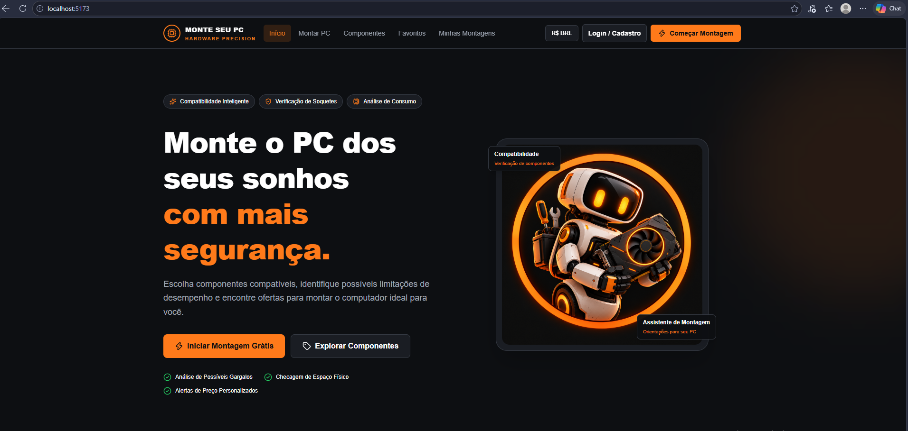
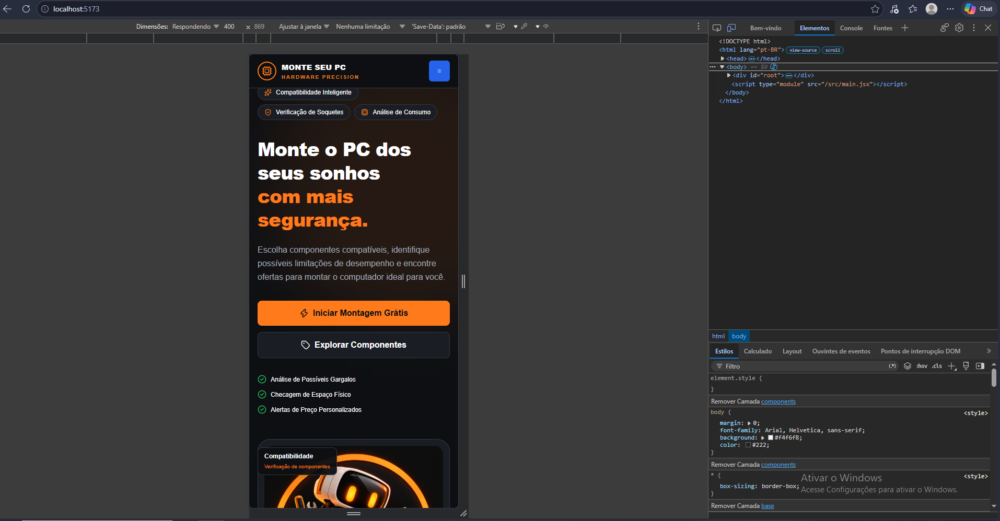
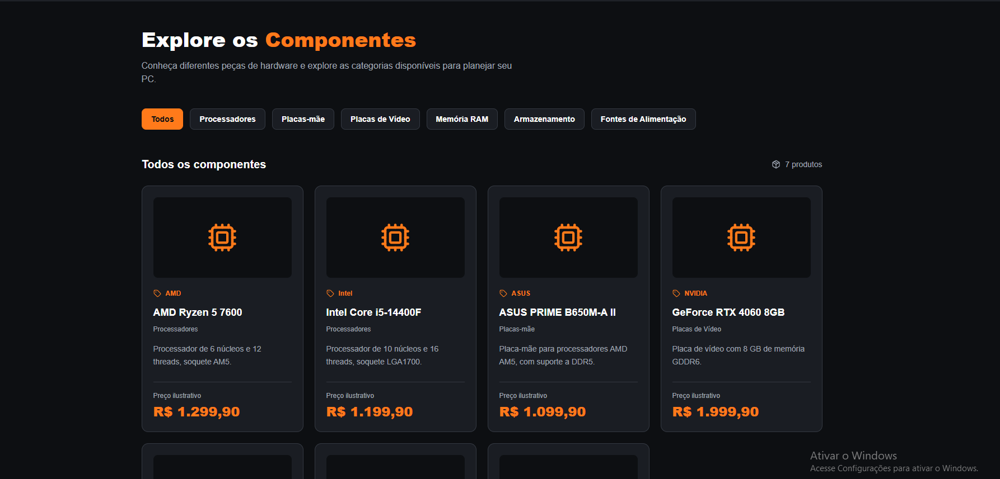
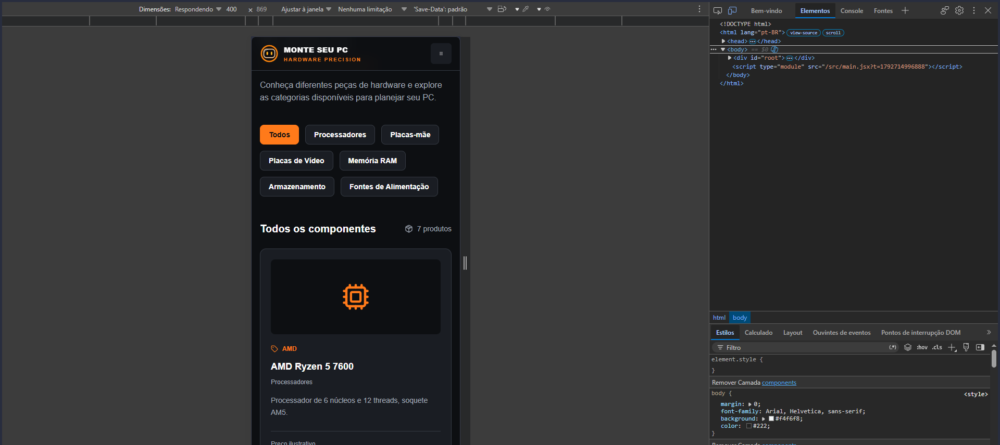
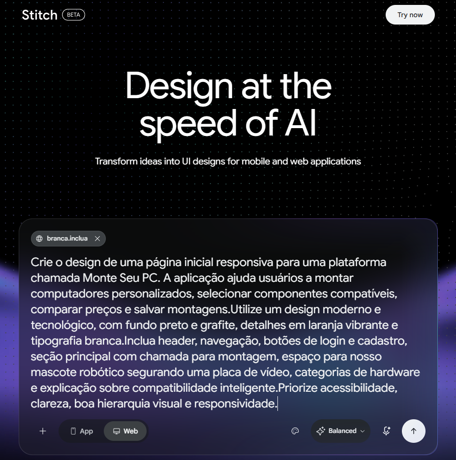
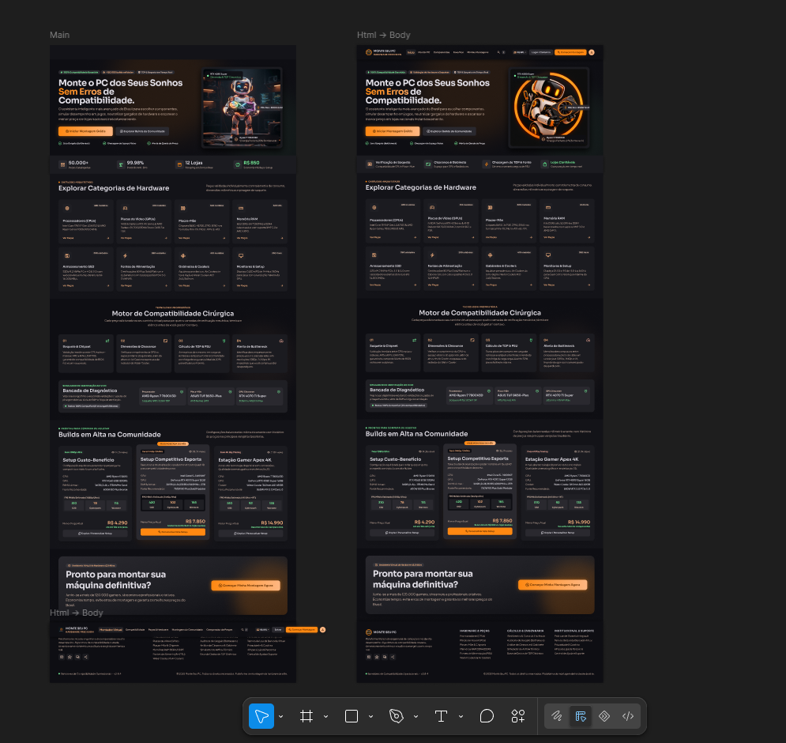
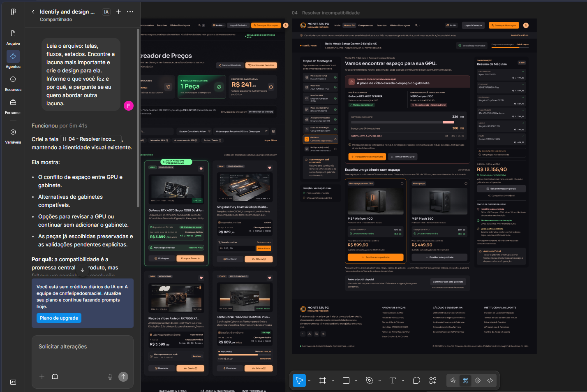
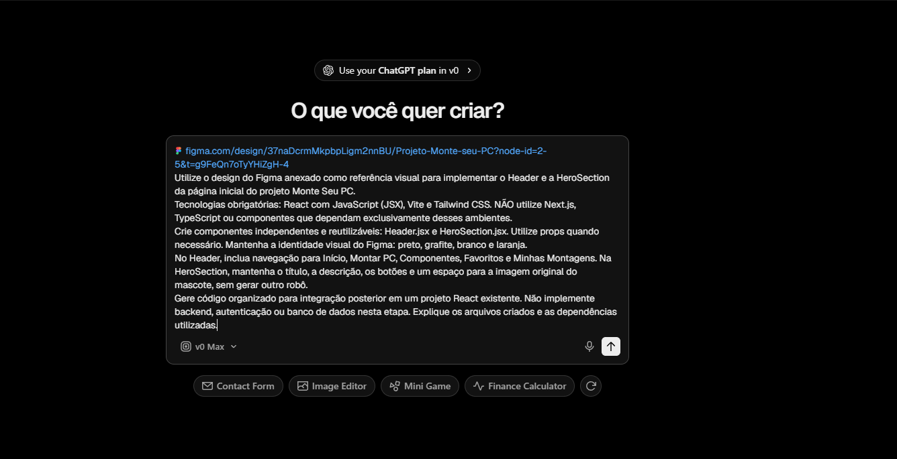

# Monte Seu PC — Plataforma de Montagem de Computadores

Plataforma web desenvolvida como projeto acadêmico da disciplina de Desenvolvimento Web, com foco na seleção de componentes de hardware, planejamento de computadores personalizados e futura verificação de compatibilidade entre peças.

O projeto também contempla a atividade **Design e Componentização Front-end com IA**, envolvendo a utilização de ferramentas de inteligência artificial para criação de interfaces, prototipação, geração de componentes React e implementação responsiva.

## Integrantes

- Heldemar Soares Braga
- Luiz Felipe dos Santos Maciel

---

## 1. Sobre o projeto

O **Monte Seu PC** tem como objetivo auxiliar usuários no planejamento e na montagem de computadores personalizados.

A proposta é disponibilizar uma plataforma na qual o usuário possa consultar componentes, explorar categorias de hardware e, futuramente, criar configurações próprias com orientações sobre compatibilidade técnica.

O desenvolvimento é realizado de forma incremental. A etapa inicial concentra-se na construção da interface, na navegação e em um catálogo demonstrativo de componentes.

### 1.1 Funcionalidades implementadas

- Página inicial personalizada.
- Cabeçalho responsivo com navegação.
- Identidade visual em preto, grafite, laranja e branco.
- Mascote original do projeto.
- Seção de categorias de componentes.
- Catálogo demonstrativo com sete produtos.
- Filtros interativos por categoria.
- Exibição de nome, marca, descrição e preço ilustrativo.
- Contador dinâmico de produtos.
- Navegação com React Router.
- Componentização em React.
- Interface adaptada para desktop e dispositivos móveis.

### 1.2 Funcionalidades planejadas

- Cadastro e gerenciamento de componentes no MongoDB.
- Montador de computadores com seleção guiada de peças.
- Verificação técnica de compatibilidade entre componentes.
- Identificação de possíveis limitações de desempenho.
- Verificação de soquetes, memória, potência e dimensões físicas.
- Salvamento de montagens.
- Lista de favoritos.
- Alertas personalizados de preços.
- Comparação de ofertas de lojas.
- Assistente virtual para dúvidas e orientações sobre hardware.

**Importante:** as funcionalidades de compatibilidade automática, monitoramento de preços e assistência virtual ainda não foram implementadas. O catálogo atual utiliza dados demonstrativos, e seus preços não correspondem a ofertas reais.

---

## 2. Tecnologias utilizadas

### Front-end

- **React 19:** construção da interface.
- **Vite:** ambiente de desenvolvimento e compilação.
- **JavaScript (JSX):** implementação dos componentes.
- **React Router DOM:** navegação entre páginas.
- **Tailwind CSS:** estilização e responsividade.
- **Lucide React:** biblioteca de ícones.
- **Axios:** comunicação com APIs na estrutura existente.

### Back-end existente

O projeto aproveita a estrutura de uma aplicação MERN desenvolvida anteriormente, utilizando:

- Node.js
- Express.js
- MongoDB
- Mongoose
- JSON Web Token (JWT)
- Bcrypt
- Dotenv
- CORS

O backend atual pertence originalmente a um sistema de gerenciamento de tarefas. Sua adaptação para componentes, usuários, favoritos e montagens faz parte das próximas etapas do Monte Seu PC.

---

## 3. Estrutura do projeto

O repositório está organizado da seguinte forma:

```text
trabalho_final_web/
│
├── README.md
│
└── monte-seu-pc/
    │
    ├── backend/
    │   └── Estrutura da API MERN original
    │
    ├── frontend/
    │   ├── public/
    │   │   └── images/
    │   │       ├── favicon.png
    │   │       ├── mascote.png
    │   │       └── mascote-assistente.png
    │   │
    │   ├── src/
    │   │   ├── components/
    │   │   │   ├── Header.jsx
    │   │   │   ├── HeroSection.jsx
    │   │   │   └── CategoriesSection.jsx
    │   │   │
    │   │   ├── data/
    │   │   │   └── componentes.json
    │   │   │
    │   │   ├── pages/
    │   │   │   ├── Home.jsx
    │   │   │   └── Componentes.jsx
    │   │   │
    │   │   ├── App.jsx
    │   │   └── index.css
    │   │
    │   ├── index.html
    │   ├── package.json
    │   └── vite.config.js
    │
    └── docs/
        ├── README-gerenciador-tarefas.md
        └── screenshots/
            ├── home-desktop.PNG
            ├── home-mobile.PNG
            ├── componentes-desktop.PNG
            ├── componentes-mobile.PNG
            ├── stitch-design.PNG
            ├── figma-design.PNG
            ├── Figma-Resolucao.PNG
            └── v0-componentes.PNG
```

A estrutura acima destaca os principais arquivos da nova interface. O projeto também preserva componentes e páginas do sistema MERN original durante a migração.

---

## 4. Design e Componentização Front-end com IA

A criação da interface do Monte Seu PC envolveu um processo de experimentação, prototipação e integração de código gerado com auxílio de inteligência artificial.

O desenvolvimento seguiu o fluxo:

**Google Stitch → Figma → v0 → React + Vite**

As ferramentas foram utilizadas como apoio à criação visual e à implementação, com revisão e adaptações posteriores no código.

### 4.1 Google Stitch

O Google Stitch foi utilizado para explorar propostas visuais para o sistema.

As principais telas trabalhadas foram:

1. Página inicial.
2. Montador de computadores.
3. Página de favoritos.

Foi adotada uma identidade visual com:

- Fundo preto e grafite.
- Laranja como cor de destaque.
- Textos em branco e cinza.
- Botões de ação em laranja.
- Elementos visuais relacionados a hardware.
- Mascote robótico como parte da identidade do projeto.

**Registro dos prompts:** não foi possível recuperar os textos originais enviados ao Stitch. O processo de criação está documentado por capturas de tela, sem atribuição de comandos que não puderam ser confirmados.

### 4.2 Figma

As interfaces criadas durante a etapa de design foram organizadas em frames no Figma.

Os principais frames trabalhados foram:

- `01 - Página Inicial`
- `02 - Montar PC`
- `03 - Favoritos`
- `04 - Resolver incompatibilidade`

A ferramenta permitiu observar a organização das telas, a hierarquia visual e diferentes estados do fluxo de montagem.

#### Uso do agente de IA no Figma

Durante o processo, foi utilizado um agente de IA para examinar as telas e identificar uma lacuna importante no fluxo da aplicação.

**Prompt original registrado:**

> Leia o arquivo: telas, fluxos, estados. Encontre a lacuna mais importante e crie o design para ela. Informe o que você fez e por quê, e pergunte se eu quero abordar outra lacuna.

**Resultado obtido:**

O agente propôs uma tela de resolução de incompatibilidade entre componentes.

O cenário representado envolve uma situação em que a placa de vídeo selecionada possui dimensões superiores ao espaço disponível no gabinete.

Essa tela contribuiu para ampliar a proposta do projeto, demonstrando como o sistema poderá orientar o usuário diante de configurações incompatíveis.

**Observação:** a tela de resolução de incompatibilidade faz parte do protótipo visual no Figma e ainda não foi implementada como funcionalidade no React.

### 4.3 v0

A ferramenta v0 foi utilizada para auxiliar na geração dos componentes iniciais da página principal.

Foram solicitados dois componentes reutilizáveis:

- `Header.jsx`
- `HeroSection.jsx`

O objetivo era transformar uma referência visual exportada do Figma em código JSX compatível com o projeto React existente, sem substituir sua estrutura.

#### Prompt original enviado à v0

> Estou anexando a imagem da página inicial do Monte Seu PC exportada do Figma e a imagem original do mascote.
>
> Utilize essas imagens como referência visual. Não é necessário acessar novamente o link do Figma.
>
> IMPORTANTE: Já tenho um projeto React 19 com Vite, React Router e Axios funcionando. Não crie outro projeto Vite e não substitua meus arquivos existentes.
>
> Gere apenas os componentes reutilizáveis Header.jsx e HeroSection.jsx, utilizando JavaScript JSX e Tailwind CSS, compatíveis com React + Vite. Não utilize Next.js ou TypeScript.
>
> Reproduza o layout, as cores preto/grafite/laranja, os textos e os espaçamentos da referência. Utilize a imagem original do mascote, sem criar outra. Crie navegação compatível com React Router, com links para Início, Montar PC, Componentes, Favoritos e Minhas Montagens.
>
> Mostre o código completo de cada componente e os estilos e dependências necessários para integrá-los ao meu projeto existente. Explique como cada componente funciona. Não altere o backend, autenticação ou banco de dados.

#### Resultado da v0

A ferramenta produziu versões iniciais dos componentes `Header.jsx` e `HeroSection.jsx`, utilizando:

- JSX
- Tailwind CSS
- React Router
- Lucide React
- Props
- useState
- Renderização dinâmica

A resposta da ferramenta também identificou dependências e orientações de integração ao projeto existente.

#### Adaptações realizadas após a geração

O código produzido foi revisado antes e durante sua integração ao sistema.

Entre as adaptações realizadas estão:

- Integração do mascote original.
- Ajustes na navegação com React Router.
- Correção da apresentação do menu mobile.
- Ajustes nos pontos de quebra responsivos.
- Configuração das cores no Tailwind CSS.
- Remoção de controles sem funcionalidades implementadas.
- Revisão dos textos sobre compatibilidade e desempenho.
- Substituição de afirmações técnicas excessivamente absolutas por descrições mais adequadas.
- Utilização do favicon personalizado no cabeçalho.
- Integração dos componentes à página inicial.

O processo demonstra que a IA foi utilizada como apoio ao desenvolvimento, enquanto a implementação final passou por revisão, testes e modificações.

---

## 5. Componentização em React

A aplicação foi organizada em componentes para separar responsabilidades, facilitar a reutilização e tornar o código mais legível.

| Componente | Responsabilidade |
|---|---|
| `Header` | Navegação principal, identidade visual e menu responsivo. |
| `HeroSection` | Apresentação do projeto, mascote e botões principais. |
| `CategoriesSection` | Exibição das categorias de hardware. |
| `ProdutoCard` | Exibição individual dos produtos do catálogo. |
| `FloatingChip` | Etiquetas visuais informativas na seção principal. |
| `MascotSlot` | Exibição da imagem do mascote e tratamento de falha no carregamento. |

O componente `ProdutoCard` foi definido na implementação da página `Componentes.jsx` para organizar a exibição dos dados de cada produto.

### 5.1 Props

As propriedades permitem transmitir informações aos componentes.

Exemplos:

- Dados de cada produto transmitidos ao `ProdutoCard`.
- Caminho e descrição do mascote transmitidos à `HeroSection`.
- Título e subtítulo utilizados nas etiquetas visuais.

### 5.2 useState

O hook `useState` é utilizado para controlar informações que mudam durante a interação com a interface.

Exemplos:

- Abertura e fechamento do menu mobile.
- Categoria selecionada no catálogo.
- Controle de falha no carregamento da imagem do mascote.

### 5.3 map() e key

O método `.map()` permite gerar elementos a partir de arrays de dados.

Sua utilização ocorre na apresentação:

- Dos links de navegação.
- Das categorias de componentes.
- Dos benefícios da página inicial.
- Dos cartões de produtos.

A propriedade `key` é utilizada para identificar os elementos renderizados nas listas.

### 5.4 filter()

O método `.filter()` permite selecionar produtos conforme a categoria ativa.

Quando o usuário escolhe uma categoria, o catálogo exibe apenas os componentes pertencentes àquela seleção.

### 5.5 Renderização condicional

A aplicação utiliza condições para apresentar diferentes estados, como:

- Menu mobile aberto ou fechado.
- Produtos encontrados ou catálogo vazio.
- Login ou acesso ao perfil, conforme a propriedade de autenticação visual.
- Imagem do mascote ou conteúdo alternativo em caso de falha.

---

## 6. Catálogo demonstrativo de componentes

A página de componentes utiliza dados mockados armazenados em:

`monte-seu-pc/frontend/src/data/componentes.json`

O catálogo contém sete produtos demonstrativos:

| Produto | Categoria |
|---|---|
| AMD Ryzen 5 7600 | Processadores |
| Intel Core i5-14400F | Processadores |
| ASUS PRIME B650M-A II | Placas-mãe |
| GeForce RTX 4060 8GB | Placas de Vídeo |
| Kingston Fury Beast 16GB DDR5 | Memória RAM |
| Kingston NV3 1TB NVMe | Armazenamento |
| Corsair CX650 650W | Fontes de Alimentação |

Cada registro apresenta:

- ID
- Nome
- Categoria
- Marca
- Preço ilustrativo
- Descrição

### Funcionalidades do catálogo

O usuário pode:

1. Visualizar todos os produtos.
2. Selecionar uma categoria.
3. Consultar os produtos filtrados.
4. Visualizar a quantidade de resultados.
5. Consultar informações básicas de cada peça.

Os valores são formatados em reais (BRL).

**Aviso:** os preços apresentados são fictícios e utilizados exclusivamente como dados demonstrativos. Não representam anúncios, disponibilidade ou ofertas em tempo real.

---

## 7. Responsividade

A interface foi desenvolvida utilizando recursos responsivos do Tailwind CSS.

Os testes visuais foram realizados no navegador, tanto em desktop quanto em uma visualização mobile com largura aproximada de 390–400 px.

### Comportamentos implementados

- Adaptação do cabeçalho para telas menores.
- Navegação mobile com menu hambúrguer.
- Reorganização dos botões da página inicial.
- Ajuste da seção do mascote para diferentes larguras.
- Distribuição responsiva das categorias.
- Reorganização dos filtros do catálogo.
- Exibição dos produtos em grade no desktop e em coluna no celular.

As capturas de tela utilizadas para registrar os testes estão disponíveis na documentação.

---

## 8. Capturas de tela

As imagens abaixo apresentam o resultado da implementação e as etapas de criação visual com auxílio de inteligência artificial.

### 8.1 Página inicial — Desktop



### 8.2 Página inicial — Mobile



### 8.3 Catálogo de componentes — Desktop



### 8.4 Catálogo de componentes — Mobile



---

## 9. Evidências das ferramentas de IA

### 9.1 Google Stitch

Captura das interfaces propostas durante a etapa inicial de design.



### 9.2 Figma — Organização das interfaces

Captura dos frames organizados no Figma.



### 9.3 Figma — Resolução de incompatibilidade

Captura da tela adicional proposta pelo agente de IA para representar a resolução de um problema de compatibilidade entre componentes.



Essa tela demonstra a exploração de estados de erro e orientação ao usuário durante o planejamento de uma montagem.

### 9.4 v0 — Geração de componentes

Captura da utilização da v0 para gerar os componentes iniciais da página principal.



---

## 10. Como executar o projeto

### 10.1 Pré-requisitos

Para executar o frontend, é necessário possuir:

- Node.js
- npm
- Git, caso seja necessário clonar o repositório

### 10.2 Clonar o repositório

```bash
git clone https://github.com/New-Felipe/trabalho_final_web.git
```

Acesse a pasta do repositório:

```bash
cd trabalho_final_web
```

Como o desenvolvimento do Monte Seu PC está na branch específica do projeto, selecione:

```bash
git switch feat/monte-seu-pc
```

### 10.3 Acessar o frontend

```bash
cd monte-seu-pc/frontend
```

### 10.4 Instalar as dependências

```bash
npm install
```

No PowerShell do Windows, também pode ser utilizado:

```powershell
npm.cmd install
```

### 10.5 Executar o servidor de desenvolvimento

```bash
npm run dev
```

No PowerShell:

```powershell
npm.cmd run dev
```

O Vite informará um endereço local, normalmente:

`http://localhost:5173/`

### 10.6 Acessar as páginas

Página inicial:

`http://localhost:5173/`

Catálogo de componentes:

`http://localhost:5173/componentes`

As páginas de montagem, favoritos e montagens salvas ainda possuem conteúdo provisório.

### 10.7 Compilar para produção

```bash
npm run build
```

No PowerShell:

```powershell
npm.cmd run build
```

A página inicial e o catálogo demonstrativo podem ser visualizados sem iniciar o backend ou conectar o MongoDB.

---

## 11. Situação atual do desenvolvimento

### Implementado

- Interface inicial do Monte Seu PC.
- Componentização React.
- Navegação entre páginas.
- Layout responsivo.
- Catálogo com sete produtos mockados.
- Filtros por categoria.
- Identidade visual e mascote.
- Documentação do processo de design assistido por IA.

### Em desenvolvimento

- Modelagem de componentes no banco de dados.
- API específica do Monte Seu PC.
- Cadastro e gerenciamento de peças.
- Montador de computadores.
- Regras técnicas de compatibilidade.
- Favoritos e montagens salvas.
- Integrações com preços e ofertas.
- Assistente virtual.

A atividade de interfaces representa a etapa inicial da evolução do projeto. A implementação completa das funcionalidades previstas será realizada posteriormente.

---

## 12. Histórico do projeto

O repositório foi utilizado inicialmente para o desenvolvimento de um **Gerenciador de Tarefas MERN**, que incluía:

- Cadastro de usuários.
- Login e autenticação JWT.
- Gerenciamento de tarefas.
- Operações CRUD.
- Persistência com MongoDB.

A documentação dessa aplicação foi preservada no arquivo:

`monte-seu-pc/docs/README-gerenciador-tarefas.md`

O Monte Seu PC está sendo desenvolvido a partir da estrutura existente, com novas páginas, componentes e funcionalidades relacionadas ao domínio de hardware.

---

## 13. Repositório

**GitHub:** https://github.com/New-Felipe/trabalho_final_web

**Branch de desenvolvimento:** `feat/monte-seu-pc`

**Projeto:** Monte Seu PC — Plataforma de Montagem de Computadores

**Disciplina:** Desenvolvimento Web

**Atividade:** Design e Componentização Front-end com IA